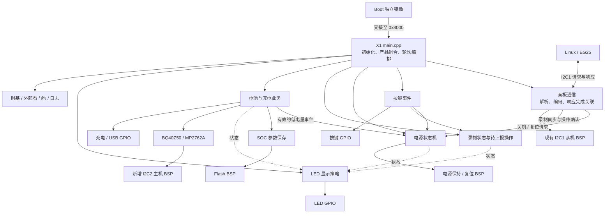

# X1 App 架构与实施计划

状态：已有可烧录测试基线及V1.3/V1.5基础HIL；本轮P3按键/电源/低电量/复位ACK流程已软件实现，复用MultiButton并通过HostTests 14/14和Debug/Release/ReleaseNoLog构建，新App尚未烧录。P1有运行/中断证据，P2支持消息1–5（此前实板仅1/2/3），P3实板待验收，P4双版本识别/采样/充电代码及基础HIL已有证据；P5 B1–B5已软件完成（HostTests 18/18、三配置构建与Host/ARM clang-tidy通过），Flash/LED实板验收及B7产物收尾待执行；P6未完整验收。产品契约见 [x1_product_contract.md](x1_product_contract.md)，源码/构建说明见 [App/README.md](../App/README.md)。旧镜像哈希、失败尝试和实板证据见 [测试基线HIL](x1_hil_test_version.md) 与 [V1.5 MP实板HIL](x1_v15_hil.md)；这些记录不证明新P3镜像的电气/按键/关机行为。

## 1. 目标与范围

基于当前 Boot/App 分离工程，先完成无屏幕的 X1 产品：开关机、Linux 面板通信、按键与录制操作、电池监测、充电保护、LED 提示及 SOC 补偿参数保存。

已确定的约束：

- 后续 X1、X1Pro、XBase 的 App 入口统一使用 `main.cpp`；此次只接入 X1，另外两个产品不创建空入口。
- X1 采用裸机轮询与非阻塞状态机，关闭 OLED/LVGL，不引入 RTOS、QuarkTS、Arduino 框架或动态任务调度器。
- 共用业务位于 `App/Shared/`，产品入口和产品参数位于 `App/Products/X1/`。既有 C 驱动继续按 C 编译，必要的 C++ 业务和芯片驱动按 C++ 编译。
- 复用现有 BSP、时基、日志与 Flash 能力；只补齐 X1 所需硬件功能，不扩展通用 OS 适配框架。
- 保留 Linux 现有面板协议的消息 ID、字段布局、CRC 和事务方式；旧代码缺陷不作为需要复刻的产品行为。
- App 不链接 `Boot/Inc` 或 Boot 升级执行代码，不写 Boot 的一次性升级完成标记。
- Boot 继续使用原有构建入口与镜像边界。公共文件确需调整时，必须验证 Boot 回归。

X1Pro/XBase 的 LVGL 与 FreeRTOS 接入是后续独立工作。本轮通过明确状态所有权、时间输入和有界业务处理，为后续任务化保留复用条件，不提前实现任务、锁或消息总线。

## 2. 依据与实施前基线

- 当前工程：`HC32F460xE_Bootloader`。目录和构建边界见 [project_structure.md](project_structure.md)。
- 历史参考：`/home/gtc/Desktop/workspace/HC32_PROJ/HC32F460xE_Arduino` 的实际分支 `X1_Panel_dev`，参考提交 `771d4ea`。使用 Git 对象读取该分支，不以旧仓库当前检出分支替代。
- 核心参考文件：旧分支的 `App/src/main.cpp`、`App/src/message_decode.{h,cpp}`、`App/src/slave_i2c.cpp`、`Platform/HAL/HAL*.cpp`、`Platform/Config/mcu_config.h`、`Platform/Core/src/Wire.cpp`、`Libraries/MultiButton/`。
- 当前 App 只有产品配置目标和镜像链接配置，尚无可执行 App。X1 使用 `app::X1` 和 `app::image`。
- Boot 占用前 32 KiB；App 区域为 `[0x00008000, 0x0007A000)`，456 KiB；App 禁止携带 ICG。
- 当前 BSP 已有时钟、1 ms SysTick、电源保持、外部看门狗、I2C1 从机、Flash、PB5 LED、复位信息和写保护接口。
- `bsp_gpio_safe_init()` 是占位，不能视为已完成 X1 GPIO 初始化；App I2C2 主机、按键、其余 LED 与充电 GPIO 尚待接入。
- BQ40Z50、MP2762A 源码存在，但仍依赖 `Wire.h`/`TwoWire`，不可直接加入当前构建。
- 顶层目前仅启用 C/ASM；工具链已配置 G++，startup 调用 `__libc_init_array`，公共链接脚本保留构造函数表。C++ 接入仍需实际编译与链接验证。
- 历史文档存在与现源码不一致的描述。实施以实际源码及本轮冻结的产品契约为准，不把历史验证记录当作新 App 的验证结果。

## 3. 目标架构与所有权

图中节点表达职责，不要求每个节点建立独立 library 或单独文件。初期可将录制状态放在共用业务状态模块，将 SOC 参数保存放在电池业务相关文件。

| 状态 / 资源 | 所有者 | 其他模块的使用方式 |
| --- | --- | --- |
| 开机、关机、复位阶段与截止时间 | 电源业务 | 提交事件，读取状态 |
| 当前录制状态与待上报操作 | 录制业务 | 按键/主机提交操作，通信读取并确认 |
| 电池采样、有效性、充电状态、补偿值 | 电池/充电业务 | 通信与 LED 读取快照，电源接收低电量事件 |
| 接收解析与当前响应事务 | 面板通信 | 业务通过明确入口接收有效命令 |
| GPIO、I2C、看门狗、Flash 硬件状态 | 对应 BSP/驱动 | 主循环上下文调用公开接口 |
| LED 模式与翻转时间 | LED 业务 | 根据业务状态计算输出，不修改电量或关机状态 |

共用业务不反向依赖产品 `main.cpp`。时间通过显式毫秒值或现有公开时基提供，使用回绕安全的时间差判断。ISR 只搬运字节、记录事件和处理硬件标志，不执行协议业务、Flash 操作或日志。

## 4. 阶段依赖与完成条件

各阶段的主机检查与硬件验收分别记录。硬件条件缺失时可继续独立的软件工作，但该阶段标记为“软件完成，硬件待验收”，不能据此宣布产品完成。产品语义未确定时，不通过猜测实现会断电、复位或改变充电状态的路径。

### P0：冻结 X1 产品、协议与存储契约

工作：

1. 核实目标 MCU、板卡版本、原理图/BOM，以及产品板与现有测试板的差异。
2. 整理实际 X1 引脚、有效电平、GPIO 上电安全状态、充电芯片方案和允许的电压/电流/温度参数。
3. 核实 PB3 实际断电范围、按键自保持电路及外部供电时的行为。Boot 已保持 PB3，旧 App 冷启动等待逻辑不能直接复制；明确开机判定、判定超时和继续充电条件。
4. 从 Linux 调用代码或真实报文确定消息类型、请求长度、读取长度、字段单位、写后读等待以及重试方式。特别明确 `0x05` 表示关机请求还是主机已完成关机。
5. 统一按键的实际毫秒时长与单次长按触发规则，修正旧按键库 5 ms 配置与 10 ms 调用的差异，不将计数直接作为新产品时长。
6. 明确 SOC 参数分区。旧地址 `0x7A000` 与 Metadata A 重合，禁止继续使用。优先评估目前未使用的 `[0x7E000, 0x80000)` 保留扇区；正式分配时同步公共地址契约、文档及范围检查，验证 Boot 擦除/升级不触碰该区域。
7. 区分普通软件复位和请求升级的主机流程。二者均受当前 Boot 软件复位入口策略影响，App 不自行写升级完成标记绕过 Boot。

交付：简洁的 X1 产品契约，包含引脚表、协议字段表、状态转换、时长参数和参数区归属。架构中已有结论直接引用，只补齐产品差异与缺口。

验收：每个硬件输出都有可核实依据；五类业务消息有明确长度和语义；参数区无重叠；上述未确定项有明确状态和依赖阶段。

### P1：接入 C++ App 镜像与最小运行时

工作：

1. 在固件和必要的主机测试配置中启用 CXX。X1 target 声明 C++17，沿用旧 App 标准；C 源码继续使用当前 C11，CPU/ABI 与工具链保持现有配置。
2. 新建 `App/Products/X1/main.cpp`，形成独立 `hc32f460_app_x1` 可执行目标，链接 `app::X1`、`app::image`，按需链接日志。
3. 检查实际消费的 C 头文件，补齐必要的 C linkage；处理 `bsp_board_config.h` 的 C 专用 `_Static_assert`，保持 C/C++ 均可使用，不扩大到无关头文件。
4. 生成 X1 的 ELF/HEX/BIN/MAP，使用独立输出名和 App 日志开关，不复用 Boot 日志开关的语义。确认 CI/本地 G++ 及所需运行库可用。
5. 初始化业务上下文、PB3 保持、时钟、时基、看门狗和日志。硬件初始化显式放在 `main()` 流程，静态构造函数不访问外设。
6. 按实际交接源码恢复中断：先准备状态与回调，再启用；确保使用 App 向量表。新增 App 自身的异常处理路径，按已确认硬件契约处理电源、指示与看门狗，不链接 Boot 私有异常代码。
7. 建立固定周期轮询与初始化失败路径，避免以持续喂狗掩盖无法继续运行的初始化故障。

验收：

- Debug/Release App 可编译链接，向量表在 `0x8000`，无 ICG，代码和初始化数据均在 App 区内。
- C/C++ 混合调用与构造函数基础检查通过；无用的异常、RTTI、动态容器和堆依赖不加入初期实现。
- 实板验证 Boot 跳转后 PB3 连续保持、SysTick 推进、PA6 继续正确服务、必要中断可运行，无默认异常陷阱。
- 公共构建/头文件的调整通过相关 Boot 回归；既有 Boot 产物路径和特性保留。

### P2：接入面板协议与 I2C 响应事务

工作：

1. 复用 I2C1 从机 BSP，App 单独实现旧 X1 的 `AA 44 18`、20 字节头和 CRC32 业务帧，不套用现有 Boot 的 7 字节头/CRC16 解析器。
2. 使用有界静态缓冲和纯协议函数，明确字节序；检查帧头、长度、消息类型、已支持 ID、每条消息的最小数据长度和 CRC，处理分段、无效帧及接收超时。
3. 按固定字节布局编码五类响应：信息 60 字节，控制 32 字节，主机状态/复位/关机各 26 字节。与 Linux 实际报文核对保留字段，避免沿用旧共享响应缓冲的残留内容。
4. 在会修改业务状态的命令执行前取得响应发布资格；不能覆盖未读响应，不能在发布失败时重复执行副作用。
5. 将待确认业务操作与其响应关联，使用现有完成计数等证据识别完整读出，避免只读瞬时 `SLAVE_TX_DONE` 状态而漏掉完成事件。
6. 明确短读重读、响应忙、总线恢复和待确认操作的处理。恢复解析器部分帧时，不误清除已发布且尚未确认的业务事件。
7. 保持“写请求 + STOP + 处理等待 + 独立读”的事务方式。P3/P4 尚未接入的业务不得返回伪造的执行成功或电池采样结果。

验收：已确定消息的黄金报文匹配；CRC 错误、短帧、越界长度、未知 ID、分段、短读、忙响应和恢复路径有最小回归检查；实板核实 Linux 读写节奏和完整响应读取。主机请求的重复执行策略按 P0 契约验证。

### P3：实现按键、电源与录制状态机

工作：

1. 接入 PA0 电源键与 PA15 功能键的已确认电平。优先复用旧 MultiButton 的 C 实现并对齐调用周期；确认一段连续长按只触发一次产品操作。
2. 实现开机判定、运行、关机通知等待、断电延时、断电后驻留，以及等待复位响应等明确状态。等待全部使用时间和事件推进。
3. 将按键关机、低电量关机、Linux 命令和强制关机统一接入电源业务，保存原因与截止时间。
4. 以旧 8 s 确认后延时和 20 s 未确认兜底作为待核实基线。响应读取完成只确认通知已送达，不能自行等同 Linux 已安全关机；按 P0 的真实主机行为决定状态转换。
5. 双击功能键产生待上报录制操作。主机同步不能覆盖未确认本地操作；响应完整读出后只确认该响应包含的操作，新发生的操作仍保留。
6. 复位请求等待其 ACK 完整读出，再走 App 软件复位入口；未读 ACK 的超时处理按产品契约确定。待复位期间保护原响应，防止后续请求覆盖或无限延长截止时间。
7. PB3 释放后若外部供电使 MCU 仍运行，保持明确的驻留状态，不自动复位并重新拉高 PB3，避免重新上电循环。

验收：按键消抖/双击/长按、重复触发、主机离线、确认前后事件、超时边界和时间回绕通过主机检查；实板验证开机判定、Linux 关机握手、强制关机、电源释放和复位后 Boot 行为。

### P4：接入电池、充电与温度保护

工作：

1. 补齐 App I2C2 主机，旧基线为 PA9/SCL、PA8/SDA、100 kHz；按实际板卡核实。提供必要的探测、寄存器读写和有限超时，失败路径释放总线状态，不复制整套 `TwoWire`。
2. 适配现有 BQ40Z50/MP2762A 芯片源码的总线调用，保留寄存器知识，明确读取长度、通信错误和数据有效性。
3. 根据用户补充，必须支持V1.3 GPIO与V1.5+ MP2762两方案，同一固件运行时识别。识别集中在电池业务，地址NACK与IO故障区分，成功后锁定；不因一次探测失败或运行时通信错误切换方案。
4. 内部电压/温度/电流使用明确单位，编码时保持旧面板字段约定。旧温度线缆字段为 BQ 原始 0.1 K 数值，电压编码存在整数伏特转换，须核对 Linux 消费方式。
5. 实现采样周期、陈旧判定、过温保护、保护恢复条件和通信故障时的充电策略，阈值来自产品契约。只有有效采样才能更新电量、触发低电量计时或解除保护。
6. 将低电量停录制与关机事件从旧 LED 函数移到业务状态机；定义 0% 有效电量的处理，避免沿用旧代码排除 0% 的边界。
7. OTS 为 MCU 温度，不能替代电池温度；首期仅在产品确有需求时接入，并保留经核实的校准参数。

验收：通信失败、短读、异常/陈旧数据、0%/100% SOC、温度边界、保护恢复与时间回绕通过聚焦检查；核实实板芯片身份、读取单位、充电 GPIO/寄存器行为，以及充电参数与故障保护。温度测试优先使用受控数据注入，电气验证遵守目标板范围。

### P5：实现三路 LED、SOC 补偿与参数保存

工作：

1. 完成 PC13 电源灯、PH2 充电灯、PB5 功能灯的已确认有效电平，LED 只消费业务状态。
2. 复核旧提示规则：电量 14%/9% 分段、正常/快速充电、满电常亮、录制闪烁及关机指示；定义优先级，模式切换显式更新输出与翻转时间。
3. 用实际经过时间实现充电时 SOC 稳定 20 分钟的补偿判断；补偿有效范围与算法按产品契约冻结。只对有效且足够新的样本判断稳定，不累计陈旧数据。
4. 参数记录采用明确字段编码、标识/版本、范围与完整性校验；复用现有 Flash BSP，写后回读验证。擦除态、损坏或中断写入恢复为安全默认补偿值，不把无效参数当作成功保存。
5. 控制写入条件与次数：无变化不写，失败不得标记已保存；不在高频路径或 ISR 中写入。
6. 测量擦除/编程引起的暂停，明确主机通信窗口、缓冲与看门狗处理。如果无法在当前 Flash 执行条件下满足时序，先调整保存时机/平台执行方案，再启用自动保存。
7. 首期按一个明确分区和最小记录实现；若产品要求断电后必须保留旧校准值，再设计双记录/双区，不引入无依据的通用存储系统。

验收：LED 模式切换与所有优先级、SOC 稳定/中断计时、无效参数及写失败通过主机检查；实板核实波形、Flash 读写和保存期间通信/喂狗行为。参数区变更通过地址范围与升级擦除回归。

### P6：完成 X1 集成与交付验收

工作：

1. 跑通上电、按键开机、Linux 通信、录制双击、电池更新、充电插拔、过温恢复、低电量、正常/强制关机和复位流程。
2. 用 X1 App 验证“复位进入 Boot → 升级 → 返回 App”，确认参数保留及 Boot/App 之间电源、看门狗与 I2C 所有权交接。
3. 覆盖主机断开/迟读/短读/重试、I2C2 失败、参数损坏以及断电后 MCU 仍被外部供电的边界。
4. 执行一次覆盖至少一个完整 20 分钟 SOC 补偿窗口的持续运行检查，使用受控有效样本覆盖补偿触发，不把普通持续运行等同稳定 SOC 验证。
5. 执行 Debug、Release、App 无日志配置和 HostTests，扩展现有 CI 为 X1 构建与产物收集，检查无 OLED/LVGL/Arduino/RTOS 源码或链接依赖。
6. 记录实际 Flash/RAM/栈占用、主循环最长间隔、单次 I2C 访问和 Flash 操作时间、响应延迟与看门狗波形。以 P0 约定的延迟预算判定，不用平均值替代最长时间。
7. 整理可复现构建命令、镜像地址、产物校验值、板卡与软件版本、测试结果及未解决项，更新 App/工程状态文档。

验收：所有必需场景具有对应软件或目标证据；既有 Boot 回归通过；X1 独立镜像满足地址与依赖边界；所有影响产品核心行为的缺口关闭。仅编译通过不视为 X1 完成。

## 5. 调度基线与接口落点

| 时机 | 工作 | 约束 |
| --- | --- | --- |
| 每次主循环 | 接收/解析、发送完成关联、总线恢复、外部看门狗轮询 | 单次处理有界，不以关中断包围业务解析 |
| 每次主循环，约5 ms库tick | MultiButton按键处理 | 库消抖/单双击使用tick；2 s/8 s产品长按使用实际时间，迟到不补采样 |
| 每次主循环 | 电源状态机与截止时间 | 按状态处理，不阻塞等待；面板处理前及采样后各推进一次 |
| 约 100 ms | LED 更新 | 不承担电量计时和关机决策 |
| 约 500 ms | 充电/保护与补偿业务 | 使用实际时间；检查采样新鲜度 |
| 约 3 s | BQ40Z50 采样 | 超时有界；不因失败发布正常数据 |

表中周期沿用已分析的逻辑作为初始值，最终以产品响应预算和目标测量校准。PA6 沿用现有看门狗间隔/脉冲契约，主循环间隔必须纳入波形验证。

建议落点：

| 路径 | 内容 |
| --- | --- |
| `App/Products/X1/main.cpp` 与 `product.cmake` | 产品入口、源文件组合、特性和明确参数 |
| `App/Shared/` | 电源/录制、按键、面板通信、电池/充电、LED；按真实职责拆文件 |
| `App/Shared/Protocol/` | 面板字节协议、CRC32、响应编码；无 BSP 依赖 |
| `Drivers/BSP/` | I2C2 主机、必要 GPIO、电源/复位公开能力及 C/C++ 兼容 |
| `Libraries/Bq40z50/`、`Libraries/Mp2762a/` | 适配后的芯片寄存器访问，不包含产品状态机 |
| `Common/Inc/firmware_layout.h` | 参数区正式归属与 Boot/App 共同地址契约 |
| `Tests/` | 沿用现有 CTest、硬件 mock 和链接检查，加入必要 X1 行为检查 |

这些是实施落点，不在计划阶段创建源码占位。App 的日志配置与版本信息明确归属，不借用 Boot 标识冒充 X1 版本。

## 6. 验证方式与进度记录

- 纯协议、状态机、按键时序、补偿算法：使用现有 CTest 和小规模断言测试，注入时间、输入与硬件结果；覆盖具体缺陷和边界，不镜像实现逐函数铺测试。
- 驱动：使用已有 HC32 mock 验证返回码、事务状态和资源恢复，目标板验证总线、电平与时序。
- 链接：扩展现有布局检查，检查 X1 的实际 C++ 镜像、初始化内容及公共头文件混合调用。
- 配置：现有 Debug/Release/HostTests 入口继续使用。`APP_ENABLE_LOGGING` 与 Boot 独立；实施后的 `ReleaseNoLog` 已显式关闭两者。
- 硬件：记录目标、镜像和观测方式，区分日志、逻辑分析仪波形、寄存器与 Flash 证据。涉及刷写、复位、断电或充电刺激时，按实际授权和已核实目标执行。
- 本次实施已完成 Debug/Release/ReleaseNoLog 的 Boot 与 X1 构建、HostTests 13/13、C/C++与构造函数链接回归及实际镜像检查。CI已配置产物收集，远端运行未验证；LSP超时。已用SEGGER Commander烧录并独立verifybin，V1.3目标约7分钟快照有684条有效Linux帧、501次完整响应读取、BQ无读失败，Flash尾部/ICG与备份一致。原始失败未隐藏，详见HIL记录。
- 本轮P3追加：复用旧MultiButton C库（本地20 ms消抖与格式化），确认PA0高/PA15低有效并加入BSP GPIO主机检查；冷启动/单次长按/双击/关机等待/重复确认/强制断电/低电量0%/无效陈旧中断/复位ACK超时与时间回绕均有主机回归。HostTests **14/14**，Debug/Release/ReleaseNoLog的Boot及App构建、三种实际App布局检查通过；Boot Debug BIN本次干净重编译哈希为`8e9fbd7ebbb5183442a05f302700ba0879d038391f94a67a2f9a11879fe665eb`，与旧HIL基线不同。新App构建ID为`x1-p3`，当前Boot/App均未在本轮烧录，HIL记录与当前构建哈希分开；镜像大小与哈希已按Arm GNU Toolchain 13.3.Rel1产物复核，见App构建说明。
- 按用户补充采用与 Boot 相同的分离架构：`main.cpp` 仅产品编排；启动/轮询位于 `App/Shared/Src/app_runtime.cpp`，异常处理位于 `App/Shared/Src/hc32f460_it.cpp`，公开接口位于 `App/Shared/Inc/app_runtime.h`。

| 阶段 | 进度 | 关闭依据 |
| --- | --- | --- |
| P0 产品契约 | 型号/两板型、P3电平/时长/关机语义已确认，仍有缺口 | 电气验收、单位消费源码、额外6/8消息与P5参数区待关闭 |
| P1 C++ 启动 | 软件完成，旧版基础实板运行通过 | VTOR/SysTick/I2C中断/PB3状态与持续运行通过；PB3连续波形、PA6精确脉冲待测 |
| P2 面板通信 | 1–5软件完成；旧版1/2/3有实板读取 | CRC/分段/忙/恢复/操作确认、4/5副作用发布与复位ACK关联通过；新镜像4/5实板待验收 |
| P3 按键/电源/录制 | 软件完成，实板待验收 | MultiButton/BSP电平、冷启动、单次长按、录制与低电量、8/20 s关机和5 s复位ACK回归通过 |
| P4 电池/充电 | 双方案代码及两板基础HIL通过，完整电气待验收 | 同BIN识别两板，MP配置写后回读/快充/BQ/Linux读取通过；插拔、电流/故障/温度保护实板待验收 |
| P5 LED/参数 | B1–B5软件完成，实板待验收 | 三灯策略、20 min SOC补偿、参数加载/验证保存与D7门控已集成；HostTests 18/18、三配置/布局/clang-tidy通过，Flash暂停/通信/喂狗与LED电平待B6 |
| P6 集成验收 | 可烧录测试基线已有基础HIL，未完整验收 | 当前镜像/哈希/日志已记录；升级闭环、全部产品场景与20分钟SOC窗口待完成 |
